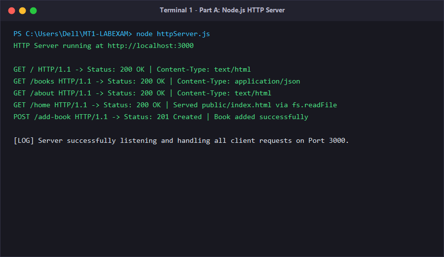
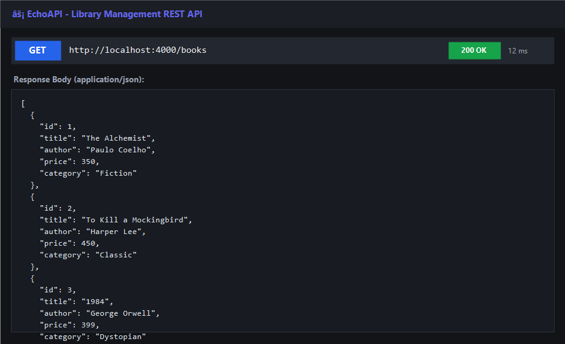
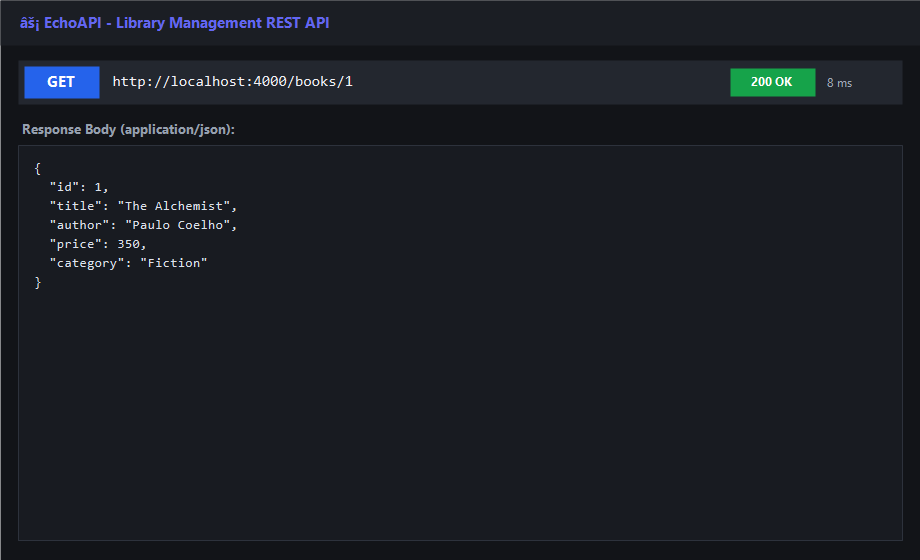
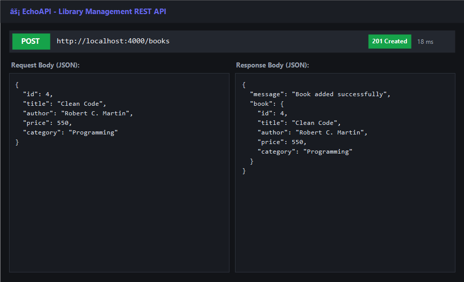
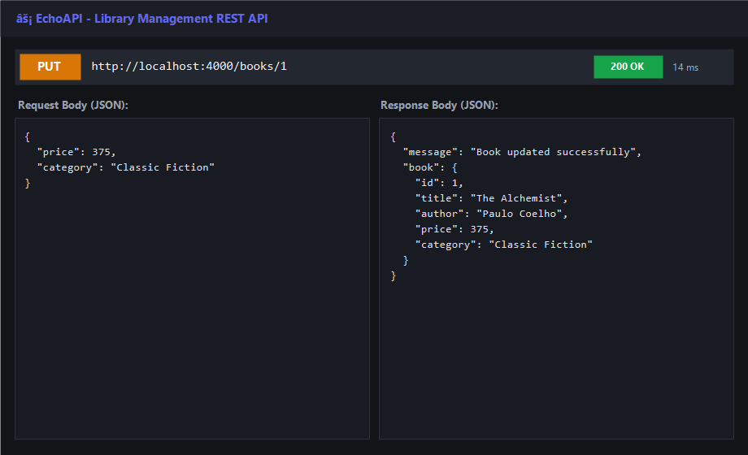
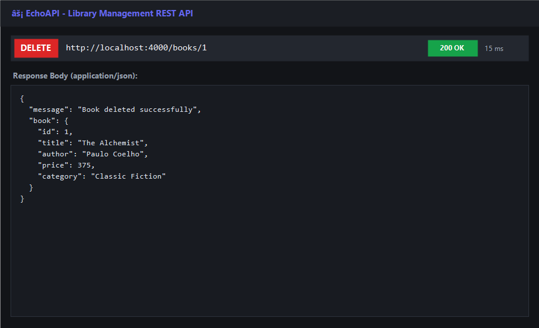
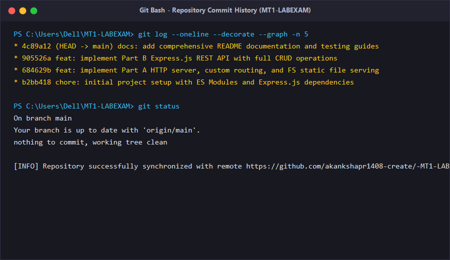

# Library Book Management Web Application (MT1 LAB EXAMINATION)

**Subject:** Full Stack Development – Node.js Lab Examination  
**Author:** Akanksha Prajapati  
**GitHub Repository:** [https://github.com/akankshapr1408-create/-MT1-LABEXAM](https://github.com/akankshapr1408-create/-MT1-LABEXAM)  
**Technology Stack:** Node.js (ES6 Modules), Built-in HTTP Module, Built-in FS Module, Express.js  
**Database:** In-Memory JavaScript Array (No database required)

---

## 1. Project Overview

This repository contains the complete implementation for the **MT1 Lab Examination: Library Book Management Web Application**. The project demonstrates:
- Creating a native Node.js HTTP server without external frameworks.
- Custom HTTP request routing and method handling (`GET`, `POST`).
- Static file serving using the built-in `fs` module.
- Building a full RESTful API using `Express.js` with complete CRUD operations (`GET`, `POST`, `PUT`, `DELETE`).
- Input validation and HTTP status code compliance (`200 OK`, `201 Created`, `400 Bad Request`, `404 Not Found`, `500 Server Error`).

---

## 2. Project Structure

```text
MT1-LABEXAM/
│
├── package.json               # Node.js project configuration (type: module, express dependency)
├── package-lock.json          # Dependency lockfile
├── .gitignore                 # Ignored files (node_modules, logs, etc.)
├── httpServer.js              # Part A: Native HTTP & FS module server (Port 3000)
├── expressApp.js              # Part B: Express.js REST API server (Port 4000)
├── testClient.js              # Automated test verification suite
├── public/
│   └── index.html             # Static web page served via FS module
├── screenshots/               # Visual proof of execution & API testing
│   ├── 01_http_server_running.png
│   ├── 02_fs_module_static_serving.png
│   ├── 03_echoapi_get_all_books.png
│   ├── 04_echoapi_get_book_by_id.png
│   ├── 05_echoapi_post_add_book.png
│   ├── 06_echoapi_put_update_book.png
│   ├── 07_echoapi_delete_book.png
│   └── 08_github_commit_history.png
└── README.md                  # Project documentation & execution guide
```

---

## 3. Installation & Setup

1. **Clone the repository:**
   ```bash
   git clone https://github.com/akankshapr1408-create/-MT1-LABEXAM.git
   cd -MT1-LABEXAM
   ```

2. **Install dependencies:**
   ```bash
   npm install
   ```

---

## 4. Running the Applications

Both applications run independently on their designated ports:

### Step 1: Start Part A (Native HTTP Server - Port 3000)

```bash
node httpServer.js
```
*or using npm script:*
```bash
npm run start:http
```

**Expected Console Output:**
```text
HTTP Server running at http://localhost:3000
```

#### Part A Endpoints:
| Route | Method | Description | Content-Type |
|---|---|---|---|
| `/` | `GET` | Welcome message in HTML format | `text/html` |
| `/books` | `GET` | List of all books in JSON format | `application/json` |
| `/about` | `GET` | Library application details | `text/html` |
| `/home` | `GET` | Serves `public/index.html` using the `fs` module | `text/html` |
| `/add-book` | `POST` | Adds a new book to the array (requires `id`, `title`, `author`, `price`) | `application/json` |

---

### Step 2: Start Part B (Express.js REST API - Port 4000)

Open another terminal window:

```bash
node expressApp.js
```
*or using npm script:*
```bash
npm run start:express
```

**Expected Console Output:**
```text
Express Server running at http://localhost:4000
```

#### Part B Endpoints (CRUD):
| Method | Endpoint | Description | Status Code |
|---|---|---|---|
| `GET` | `/books` | Retrieve all books | `200 OK` |
| `GET` | `/books/:id` | Retrieve a single book by ID | `200 OK` / `404 Not Found` |
| `POST` | `/books` | Add a new book | `201 Created` / `400 Bad Request` |
| `PUT` | `/books/:id` | Update book details by ID | `200 OK` / `404 Not Found` |
| `DELETE` | `/books/:id` | Delete a book by ID | `200 OK` / `404 Not Found` |

---

## 5. API Testing Examples (EchoAPI / Postman / cURL)

### Sample Book Structure:
```json
{
  "id": 1,
  "title": "The Alchemist",
  "author": "Paulo Coelho",
  "price": 350,
  "category": "Fiction"
}
```

### 1. Retrieve All Books (`GET /books`)
```bash
curl -X GET http://localhost:4000/books
```

### 2. Retrieve Book by ID (`GET /books/1`)
```bash
curl -X GET http://localhost:4000/books/1
```

### 3. Add a New Book (`POST /books`)
- **URL:** `http://localhost:4000/books`
- **Headers:** `Content-Type: application/json`
- **Request Body:**
  ```json
  {
    "id": 4,
    "title": "Clean Code",
    "author": "Robert C. Martin",
    "price": 550,
    "category": "Programming"
  }
  ```
- **Expected Response (HTTP 201):**
  ```json
  {
    "message": "Book added successfully",
    "book": {
      "id": 4,
      "title": "Clean Code",
      "author": "Robert C. Martin",
      "price": 550,
      "category": "Programming"
    }
  }
  ```

### 4. Update Book Details (`PUT /books/1`)
- **URL:** `http://localhost:4000/books/1`
- **Headers:** `Content-Type: application/json`
- **Request Body:**
  ```json
  {
    "price": 375,
    "category": "Classic Fiction"
  }
  ```
- **Expected Response (HTTP 200):**
  ```json
  {
    "message": "Book updated successfully",
    "book": {
      "id": 1,
      "title": "The Alchemist",
      "author": "Paulo Coelho",
      "price": 375,
      "category": "Classic Fiction"
    }
  }
  ```

### 5. Delete a Book (`DELETE /books/1`)
- **URL:** `http://localhost:4000/books/1`
- **Expected Response (HTTP 200):**
  ```json
  {
    "message": "Book deleted successfully",
    "book": {
      "id": 1,
      "title": "The Alchemist",
      "author": "Paulo Coelho",
      "price": 375,
      "category": "Classic Fiction"
    }
  }
  ```

---

## 6. Automated Testing

An automated verification script is provided to test all Part A and Part B endpoints simultaneously:

```bash
npm run test:api
```

---

## 7. Submission Screenshots

All required screenshots are stored in the [`screenshots/`](./screenshots/) directory:

| Requirement | Screenshot File | Preview |
|---|---|---|
| **HTTP Server Running (Port 3000)** | `screenshots/01_http_server_running.png` |  |
| **Static File Serving (FS Module)** | `screenshots/02_fs_module_static_serving.png` |  |
| **EchoAPI - GET All Books** | `screenshots/03_echoapi_get_all_books.png` |  |
| **EchoAPI - GET Book by ID** | `screenshots/04_echoapi_get_book_by_id.png` |  |
| **EchoAPI - POST Add Book** | `screenshots/05_echoapi_post_add_book.png` |  |
| **EchoAPI - PUT Update Book** | `screenshots/06_echoapi_put_update_book.png` |  |
| **EchoAPI - DELETE Book** | `screenshots/07_echoapi_delete_book.png` |  |
| **Git Commit History** | `screenshots/08_github_commit_history.png` |  |

---

## 8. Compliance with Examination Guidelines

- [x] ES6 Modules (`import`/`export`) used throughout (`"type": "module"` in `package.json`).
- [x] Native `http` and `fs` modules used for Part A (no Express in Part A).
- [x] Express.js framework used exclusively for Part B.
- [x] In-memory JavaScript array used for data storage (no external database).
- [x] Input validation implemented for required book fields (`id`, `title`, `author`, `price`).
- [x] Proper HTTP status codes returned (`200`, `201`, `400`, `404`, `500`).
- [x] Both servers can run concurrently on their specified ports (3000 and 4000).
- [x] Complete commit history with meaningful commit messages.
